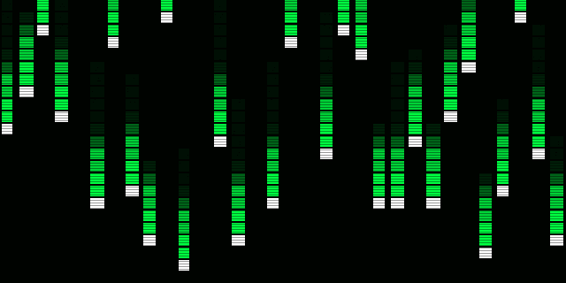

# HACK THE PLANET

> *"Systems don't change the world… people do."* — Urcuqui



A four-mission cyberpunk browser game. You start as KUKY, breaking into the PandeCorp arena, and go on to hunt rogue AIs, work the streets of a neon Miami as GHOST, and race the circuit against eight AI rivals. All four missions are reached from one **Mission Hub** that tracks your progress.

Everything runs in the browser with plain HTML, CSS and JavaScript. There's no build step, no framework and no backend. All music and sound effects are generated live with the Web Audio API, so the game ships no audio files.

---

## Missions

| # | Mission | Type | Win condition |
|---|---------|------|---------------|
| 01 | **FSOCIETY Arena** (`level1.html`) | Three.js first-person arena + ~68 s cinematic intro | Be the first to 3 kills against the PandeCorp security drone |
| 02 | **Vulnerability Hunter** (`level2.html`) | 2D canvas exploration + AI-security quiz battles | Patch all 6 AI vulnerabilities before your integrity reaches 0% |
| 03 | **Social Engineer** (`level3.html`) | Three.js open Miami city, NPC dialogues, drivable cars | Get intel from 5 targets with the right social-engineering technique, **then** beat CIPHER (4 AI threat-intel questions) |
| 04 | **Neon Grand Prix** (`level4.html`) | Canvas pseudo-3D racer, 8 AI rivals, day/night cycle | Finish all 3 laps. *Bonus objective:* take P1 |

### Campaign progression

- Only Level 1 is available at first. Beating a level's win condition unlocks the next one.
- Completed levels show **COMPLETED** in the hub and can be replayed. Replaying never re-locks anything.
- Progress is saved in your browser's `localStorage` (key `htp.progress`) and survives a page refresh. **RESET PROGRESS** in the hub wipes it after you confirm.
- What gets saved: completed levels, the highest unlocked level, first and last completion times, and a few best results (Level 2: highest integrity remaining; Level 4: best finishing position and best time).
- Just opening a level page never marks it complete. Each game records completion itself, once, when its own win condition is met.
- Every level can still be opened directly by its URL, locked or not. Progress is a convenience, not access control.

---

## Running the game

```bash
git clone https://github.com/urcuqui/hack-the-planet.git
cd hack-the-planet
```

**Option A: local server (recommended)**

```bash
npm start            # or: node tools/serve.js
# open http://127.0.0.1:8080/
```

The server needs only Node.js (≥ 22) and has no npm dependencies. It binds to `127.0.0.1` by default; set `HOST` and `PORT` to change that.

**Option B: open the file directly**

Open `index.html` in a browser. Everything works from `file://`, including saved progress, because the shared module is a classic script and not an ES module. A few browsers isolate `localStorage` for `file://` pages, so if progress doesn't stick, use Option A.

### Browser requirements

- A current Chrome, Edge, Firefox or Safari with WebGL (Levels 1 and 3) and the Web Audio API.
- An internet connection on first load: Levels 1 and 3 load **three.js r128** from cdnjs (pinned version, Subresource Integrity checked).
- Audio only starts after you click or press a key, as browser autoplay rules require.
- Built for desktop with a keyboard and mouse. The hub is responsive, but the games themselves aren't designed for touch.

---

## Controls

| Level | Controls |
|-------|----------|
| **Hub** | `Tab` / arrow keys to move between missions · `Enter` to launch |
| **01 FSOCIETY Arena** | Click or any key to start the intro · `[ SKIP ]` button · `↑ ↓` move · `← →` turn · `Space` jump · Left click fire · `♪ BGM` button toggles music |
| **02 Vulnerability Hunter** | `WASD` / arrows move · `1–4` or `↑ ↓` choose a patch · `Enter` confirm · on the end screen `Enter` next mission / restart, `H` hub |
| **03 Social Engineer** | `WASD` move · mouse drag rotate camera · `E` talk / enter or exit car · `Esc` close dialogue · `M` music |
| **04 Neon Grand Prix** | `W` / `↑` accelerate · `S` / `↓` brake · `A D` / `← →` steer · `Space` boost · `M` music |

Every level has a **MISSION HUB** link on its start screen and on its end screens (success, and failure where a level can be lost).

---

## Mission notes

**Level 1.** The cinematic intro has 11 scenes: matrix rain, the PandeCorp skyline, a surveillance scan, a terminal break-in, a world-map cyberattack and the logo shatter. The PandeCorp drone is a three-state machine:

```
PATROL ──(dist < 18)──► CHASE ──(dist < 8)──► ATTACK
       ◄──(dist > 22)──       ◄──(dist > 11)──
```

**Level 2.** A wrong patch costs 10% integrity and lets you try again in the same battle. At 0% the mission fails, and `Enter` restarts the level cleanly: full integrity, all six robots back. Topics covered: prompt injection, data poisoning, model inversion, adversarial examples, training-data bias and hallucination.

**Level 3.** The five targets teach baiting, impersonation, pretexting, quid pro quo and elicitation. CIPHER refuses to engage until you hold all five intel files, and the boss prompt shows your count (for example `LOCKED (3/5 INTEL)`).

**Level 4.** Race time starts at **GO**, not at the start of the countdown. Your finishing position is recorded separately from completion.

The educational text is deliberately simplified. Where a mitigation reduces a risk rather than removing it (input filtering against prompt injection, RAG against hallucination, adversarial training against evasion), the game says so.

---

## Project structure

```
hack-the-planet/
├── index.html               # Mission Hub (campaign map, status, reset)
├── level1.html              # 01 FSOCIETY Arena: cinematic intro + FPS (three.js)
├── level2.html              # 02 Vulnerability Hunter: 2D canvas + quiz battles
├── level3.html              # 03 Social Engineer: Miami city (three.js)
├── level4.html              # 04 Neon Grand Prix: canvas racer
├── js/
│   └── progress.js          # Shared campaign state: level list, unlocks, localStorage
├── tools/
│   ├── serve.js             # Hardened local static server
│   └── check-scripts.js     # Syntax check for every inline <script>
├── tests/
│   ├── progress.test.js     # Progression, unlock and storage-failure tests
│   ├── serve.test.js        # Static server: valid, missing, malformed, traversal
│   ├── pages.test.js        # Links, completion hooks, SRI, intro still present
│   └── browser/
│       ├── cdp.js               # Minimal DevTools Protocol client (no dependencies)
│       ├── smoke.browser.js     # Headless Chrome campaign run (hooks + navigation)
│       └── gameplay.browser.js  # Plays the levels with real keyboard/mouse input
├── gen_gif.py               # Generates the trailer GIF (needs ImageMagick)
├── preview.gif              # README preview
├── package.json             # npm scripts only, no dependencies
└── LICENSE
```

Each level is still a self-contained HTML file with its own engine, rendering and audio. The only shared code is `js/progress.js`, which exposes `window.HTPProgress`:

| Function | Purpose |
|----------|---------|
| `recordCompletion(levelId, result?)` | Called by a level when its win condition is met. Saves the completion and any best results |
| `load()` | Current state. Missing, corrupt or inaccessible storage gives a fresh campaign |
| `statusOf(state, id)` | `'locked'`, `'available'` or `'completed'` |
| `nextLevel(id)`, `HUB_URL`, `LEVELS` | Campaign order and navigation |
| `reset()`, `isPersistent()` | Hub reset and the "progress can't be saved" warning |

---

## Testing

```bash
npm test               # unit + static tests (Node built-in test runner, no browser)
npm run test:browser   # headless Chrome smoke test of the whole campaign (~30 s)
npm run test:gameplay  # headless Chrome, real keyboard/mouse input only (~4 min)
npm run check          # syntax check of all inline scripts only
```

- `npm test` covers progression and unlock logic, corrupt and throwing `localStorage`, the static server (valid files, 404s, malformed URLs, `..` and encoded traversal, sibling-prefix paths, dotfiles, symlink escape) and page wiring.
- `npm run test:browser` starts the local server and drives Chrome over the DevTools Protocol. It walks the hub and all four levels in order and checks that:
  - audio only starts after a real click
  - skipping the intro can't reopen the menu mid-match
  - Level 2 defeat and restart work
  - the Level 3 boss stays locked until five intel files are collected
  - Escape is safe during the boss
  - Level 4 records position and time
  - progress survives a reload and a confirmed reset clears it
  - no page logs a console error

  It needs Chrome or Chromium (`CHROME_PATH` to override) and network access to cdnjs, and skips itself if no browser is found.
- `npm run test:gameplay` plays with real key and mouse events only; it reads game state to steer and to assert, but never writes it. It covers:
  - the hub with Tab/arrows/Enter and reduced motion
  - the full Level 1 intro without skipping, then skip + a 3-kill win with arrows and clicks
  - Level 2 defeat by wrong patches, restart, and all six patches by walking
  - Level 3 start on a short window, one target, the locked boss and a car
  - Level 4's three laps with the keyboard
  - that each music toggle actually silences the scheduled music (an audio-graph probe, not listening)

  It uses the real GPU when headless Chrome can and falls back to software WebGL, which is much slower. Level 3's full five-target-and-CIPHER run takes several minutes, so it's in the manual checks below.

### Manual checks (things automation can't judge)

1. Play the whole Level 1 intro without skipping: scenes, narration and audio drone, then the menu.
2. Listen to the music in each level, and check that `M` (Levels 3–4) / `♪ BGM` (Level 1) toggles it right away. Level 2 has no toggle.
3. Play Level 3's five targets and CIPHER (the automated gameplay test covers one target and the locked boss). Check each success screen's **next mission** and **hub** buttons.
4. Try for P1 in Level 4. Finishing is verified automatically; whether first place is a fair challenge needs a human.
5. In the hub, turn on *reduce motion* in the OS. The matrix rain and title glitch should stop.
6. Resize the hub to phone width: cards stack in one column, with no horizontal scroll.

### Trailer GIF

```bash
python3 gen_gif.py                 # writes ./trailer.gif (git-ignored)
python3 gen_gif.py out/teaser.gif  # or any path; HTP_GIF_OUTPUT also works
```

---

## Security and provenance notes

- **Third-party code.** three.js r128 is the only external script. It's pinned to an exact version and loaded with `integrity` (SHA-384) and `crossorigin`, so a modified CDN file is refused. The trade-off is that the game needs the CDN; vendoring the file would make it fully offline.
- **Dynamic HTML.** Game UI that inserts data (end screens, intel log, race standings, car cards, hub cards) uses `textContent` and DOM nodes, not HTML string interpolation. No `eval` or dynamic code execution.
- **Local server.** Serves only known asset types from the repo root and refuses dotfiles, `tools/` and `tests/`. Paths are checked with `path.relative` after URL decoding and again after resolving symlinks. Binds to localhost by default and is meant for development only.
- **Progress storage.** Kept in `localStorage`, so players can edit it. It's a convenience, not a trust boundary.
- **Audio.** All music and SFX are synthesised in code; no audio files ship. Some tracks are written as *homages* (code comments mention a Mega Man X–style theme, a motif "inspired by" Linkin Park's *In The End*, and a "Vice City" feel). These are original note sequences, but anyone distributing the game commercially should confirm none of them reproduces a copyrighted melody closely.
- **Names.** Level 3 shows a real conference name (*Ekoparty*) on the convention center sign, and Level 4's subtitle mentions *Top Gear* as inspiration. Both are references, not affiliations.

---

## Known limitations

- three.js is fetched from a CDN, so Levels 1 and 3 need a network connection the first time.
- Built for desktop and keyboard; the levels don't have touch controls.
- Levels 1 and 3 need WebGL. Very old GPUs or blocked WebGL will show a blank scene.
- Progress is stored per browser and per origin, so `file://` and `http://127.0.0.1:8080` keep separate progress.
- The Level 1 intro plays on every visit; use `[ SKIP ]` on replays.
- The smoke test triggers win conditions programmatically. The gameplay test plays with real input, but its bots read exact positions, so it shows that a level can be beaten, not how hard it feels.
- Level 2 has no music toggle. Two of its robots spawn on obstacle tiles and stay put; you trigger them from an adjacent tile.

---

## License

[MIT](LICENSE) © 2026 Christian Urcuqui

> *The system is watching. Are you ready to break it?*
